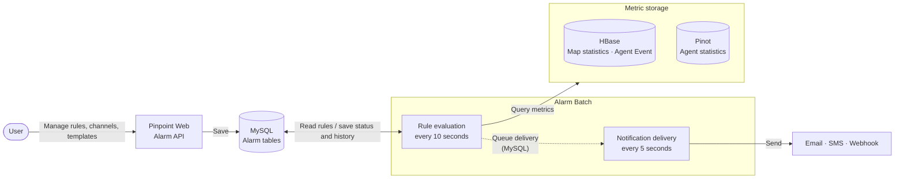
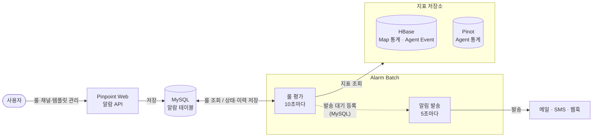

[English](alarm.md#service-alarm) | [한국어](alarm.md#service-alarm-ko)
# Service Alarm <a id="service-alarm"></a>

Pinpoint now has the Service feature, and a new Service Alarm screen lets you set alarms for each service. Service Alarm runs alarm rules on the applications of a service. When a rule condition is met, it sends a notification through a channel.

The legacy alarm works only in the `DEFAULT` service. For a service that you create, manage the alarms of its applications on the Service Alarm screen.

Service Alarm requires the Service Map feature. If `pinpoint.modules.web.servicemap.enabled` is `false`, all applications belong to the `DEFAULT` service, and only the legacy alarm screen appears.

### Main Changes

| Item | Legacy Alarm | Service Alarm |
|---|---|---|
| Service | `DEFAULT` | A service that you create |
| Channel | Set for each rule | Registered once per service and shared by many rules and templates |
| Rule registration | Register the same rule again for each application | Make a template and apply it to many applications |
| Condition | One simple comparison on one metric | Many metrics combined with `AND`/`OR` |
| Operator | Fixed for each checker | Select `>`, `>=`, `<`, or `<=` |
| Evaluation window | Fixed at 5 minutes | Set for each rule |
| Repeat notification | Sent at the 1st, 3rd, 7th, 15th... consecutive detection | Set the interval with Action Interval |

For the full comparison, refer to [9. Legacy Alarm and Service Alarm Comparison](alarm.md#alarm-comparison).

### Notes

- Legacy rules do not move to Service Alarm automatically.
  - If you move an application to a service, register its Service Alarm rules again.
- The legacy alarm of the `DEFAULT` service continues to run in `alarmJob` of the `batch` module.
- During the migration, if you enable the same condition in both the legacy alarm and Service Alarm, you get duplicate notifications.

Service Alarm needs a separate Alarm Batch process. The operation guide starts at [10. Components](alarm.md#alarm-components).

# User Guide

## 1. Open the Alarm Screen

1. Select the service to set alarms for.
2. At the bottom left, click **Service → Alarm**.
3. At the top, select an application.

The alarm screen has three tabs.

| Tab | Description |
|---|---|
| Rules | Register and manage the rules of the selected application. |
| Channels | Register the channels that receive notifications. |
| Templates | Group many rules into one template and apply it to many applications. |


## 2. Register a Rule

On the **Rules** tab, click **Add Rule**, enter the items below, and click **Add**. To change a registered rule, click **Save**.

| Item | Description |
|---|---|
| Name, Description | Rule name and description. They appear in the notification message. |
| Severity | Notification level. `WARNING` or `CRITICAL` |
| Data Source | Data that the condition uses. Refer to [3. Data Sources and Metrics](alarm.md#alarm-data-sources). |
| Check Interval | How often the condition is checked |
| Action Interval | Minimum interval before the same rule sends a notification again |
| Condition | Condition that sends a notification. Refer to [Condition](alarm.md#alarm-condition) below. |
| Filters | Conditions that narrow the target. Some data sources do not support filters. |
| Notification Channels | Channels that receive the notification |


### Condition <a id="alarm-condition"></a>

A condition has a metric, an aggregation, a comparison operator, a threshold, and an evaluation window (Window).

- Select a comparison operator from `>`, `>=`, `<`, and `<=`.
- To add a condition, click **Add Condition**.
- To combine conditions with `AND` or `OR`, click **Add Group**.

> Set the Window to the Check Interval or longer. If the Window is shorter, the data between two checks is not evaluated.


## 3. Data Sources and Metrics <a id="alarm-data-sources"></a>

| Data Source | Metric | Aggregation | Filter | Remarks |
|---|---|---|---|---|
| Application Response | Slow Count, Error Count, Total Count | SUM | Not supported | |
| | Slow Rate (%), Error Rate (%) | Ratio over the whole window | | |
| | Apdex Score | Score over the whole window | | 0 to 100 |
| Calls To Another Application | Slow Count, Error Count, Total Count | SUM | `callee`, `callee_host` | |
| | Slow Rate (%), Error Rate (%) | Ratio over the whole window | | |
| Agent Stat | Heap Usage Rate (%), JVM CPU Usage Rate (%), System CPU Usage Rate (%), Open File Descriptor Count, Connection Pool Usage Rate (%) | MAX, MIN, AVG | Not supported | Aggregates the value of each agent. The notification shows the agents that crossed the threshold. |
| Agent Event | Deadlock Detected | None | Not supported | Sends a notification when a new deadlock occurs. No threshold. |

### Application Response and Calls To Another Application

- `Application Response` counts the requests that the application receives.
- `Calls To Another Application` counts the calls that the application sends to other targets, such as a DB or an external API.

For example, one incoming request calls the DB three times and an external API once. Then the Total Count of `Application Response` is 1, and the Total Count of `Calls To Another Application` is 4.

### Filters

- Only `Calls To Another Application` supports filters. For a data source without filter support, the add filter button is disabled.
- `callee` specifies the target application. `callee_host` specifies the target host.
- If you add many filters, only the calls that match all filters are counted.
- Without a filter, the calls to all targets are added together. Then the failures of one target can be hidden by the successful calls to other targets. Specify the target.
  - Example: 9,900 successful DB calls and 100 failed external API calls give a total Error Rate of 1%.

## 4. Register a Channel

1. On the **Channels** tab, click **Add Channel**.
2. Enter the name, the channel type, and the recipient, and click **Add**.

| Type | Recipient | Remarks |
|---|---|---|
| EMAIL | User Group | Sends to the email addresses of the user group members. |
| SMS | User Group | The operator must register an SMS implementation. Refer to [12. Run Alarm Batch](alarm.md#alarm-batch). |
| WEBHOOK | URL | Format is `DEFAULT` or `SLACK`. A private address works only for hosts that the operator allows. A channel with a blocked address can be saved, but it sends no notification. |


Channels work as follows.

- If you select a user group without recipients, a warning appears in the channel list and in the channel selection of rules and templates.
- Many rules and templates in the same service can share one channel.
- When you change a channel, all later notifications through that channel use the change.


## 5. Templates and Presets

A template is a group of rules. Apply one template to many applications to use the same alarm criteria.

### Make a Template

1. On the **Templates** tab, click **Add Template**.
2. Select the rules for the template and click **Start with N rules**. You can select many items from the three groups below.
3. Adjust the template name, channels, and rules, and click **Save**.

| Group | Description |
|---|---|
| Start from a preset | Built-in rule groups. Refer to [Built-in Presets](alarm.md#alarm-presets). |
| Copy one of my templates | Templates registered in this service |
| Import standalone rules | Rules registered directly on an application |

- The selected rules are copied into the new template. Later changes to the source preset, template, or rule do not change the new template.
- To start with an empty template, select nothing and click **Start empty**.


### Apply a Template to an Application

1. On the **Rules** tab, select an application.
2. Click **Add from template** and select a template.

You cannot select a template that is already applied to the application.


### Effect of Template Changes

| Action | Effect |
|---|---|
| Change a template | The change applies to the rules of all applications that use the template. Added and removed rules also apply. |
| Change template channels | The change applies to all rules made from the template. |
| Remove a template from an application | Deletes only the rules made from that template in the selected application. |
| Delete a template | Deletes the rules made from that template in all applications. |

> If you change a value of a template rule directly on an application, later template changes do not change that value.

### Built-in Presets <a id="alarm-presets"></a>

**Agent Health Basics**: Monitors agent health with heap, CPU, and connection pool usage, and deadlocks.

| Rule | Severity | Condition | Check / Action |
|---|---|---|---|
| High heap usage | WARNING | Heap Usage Rate MAX >= 90% in 10 minutes | 5 min / 30 min |
| High JVM CPU usage | WARNING | JVM CPU Usage Rate MAX >= 90% in 10 minutes | 5 min / 30 min |
| High connection pool usage | CRITICAL | Connection Pool Usage Rate MAX >= 90% in 10 minutes | 5 min / 30 min |
| Deadlock detected | CRITICAL | A new deadlock occurs | 5 min / 60 min |

**Response Quality Basics**: Monitors response quality with error rate, slow rate, and Apdex.

| Rule | Severity | Condition | Check / Action |
|---|---|---|---|
| High error rate | CRITICAL | Error Rate >= 10% in 5 minutes | 3 min / 30 min |
| High slow rate | WARNING | Slow Rate >= 20% in 5 minutes | 3 min / 30 min |
| Apdex drop | WARNING | Apdex Score < 70 in 5 minutes | 3 min / 30 min |

## 6. Status and History

### Rule Status

| Status | Description |
|---|---|
| `NORMAL` | The condition is not met. |
| `FIRING` | The condition is met and the alarm fired. |
| `CHECK_FAILED` | The data query, the evaluation, or the notification preparation failed. |

### History

| Event | When it is recorded | Notification |
|---|---|---|
| `FIRED` | When the alarm fires and sends a notification. A repeat inside the Action Interval is not recorded. | Sent |
| `RESOLVED` | When the rule returns to normal from `FIRING` or `CHECK_FAILED` | Not sent |
| `CHECK_FAILED` | When a check fails for the first time. Continued failures are not recorded again. | Not sent |

- In the rule list, click **Actions → History** to see the current status and the history of a rule.
- The history keeps the rule settings and the measured values at the time of the alarm. Later rule changes do not change the history.


### Notification Content

A notification includes the service, the application, the rule, and the measured values.

| Button | Destination |
|---|---|
| View Details | The Service Map for the time range of the alarm. Inspector for Agent Stat and Agent Event rules |
| Alarm History | The history of the rule |


## 7. Input Limits

| Item | Limit |
|---|---|
| Rule name / description | 255 / 1000 characters |
| Rules in a template | 30 per template |
| Conditions | 10 conditions and groups in total, group depth 2 |
| One group | 3 conditions, 2 subgroups |
| Filters | 5 per rule, 512 characters per value |
| Window | 1 minute to 24 hours (except metrics without a threshold) |
| Check Interval | 1, 3, 5, 10, 30, 60 minutes |
| Action Interval | 5, 10, 30 minutes, 1, 6, 12, 24 hours |

## 8. Migrate Legacy Alarm Rules

Legacy rules do not move automatically. Legacy rules have no severity, Action Interval, or shared channel, and their window and check interval are fixed. Register new Service Alarm rules with the mapping below.

| Legacy checker | Data Source | Metric and settings |
|---|---|---|
| `SLOW_COUNT`, `SLOW_RATE` | Application Response | Slow Count, Slow Rate (%) |
| `ERROR_COUNT`, `ERROR_RATE` | Application Response | Error Count, Error Rate (%) |
| `TOTAL_COUNT` | Application Response | Total Count |
| `APDEX_SCORE` | Application Response | Apdex Score. To keep the legacy behavior, select `<=`. |
| `*_TO_CALLEE` | Calls To Another Application | Same metric. Move the target in the notes of the legacy rule to the `callee` or `callee_host` filter. |
| `HEAP_USAGE_RATE`, `JVM_CPU_USAGE_RATE`, `SYSTEM_CPU_USAGE_RATE`, `FILE_DESCRIPTOR_COUNT` | Agent Stat | Same metric. To keep the legacy behavior, select the `MAX` aggregation and `>=`. |
| `DATASOURCE_CONNECTION_USAGE_RATE` | Agent Stat | Connection Pool Usage Rate (%). To keep the legacy behavior, select the `MAX` aggregation and `>`. |
| `DEADLOCK_OCCURRENCE` | Agent Event | Deadlock Detected |

The SMS, email, and webhook settings of legacy rules do not move. Register channels in the service and connect them to the rules.

### Migration Steps

1. Make the Service Alarm rule in the disabled state.
2. Compare the service, condition, threshold, target, and recipients with the legacy rule.
3. Disable the legacy rule and enable the Service Alarm rule immediately.
4. Make sure that notifications arrive and the history is recorded.

## 9. Legacy Alarm and Service Alarm Comparison <a id="alarm-comparison"></a>

| Item | Legacy Alarm | Service Alarm |
|---|---|---|
| Management unit | Application | Application of a service |
| Condition | One metric per rule | Combined conditions with `AND`/`OR` |
| Comparison | Fixed for each checker (Apdex: less than or equal, connection pool: greater than, others: greater than or equal) | Select `>`, `>=`, `<`, or `<=` |
| Evaluation window | Fixed at 5 minutes | Window for each rule |
| Check interval | Fixed at 3 minutes | 1, 3, 5, 10, 30, 60 minutes |
| Repeat notification | Sent at the 1st, 3rd, 7th, 15th... consecutive detection | Action Interval |
| Agent condition | Fires when any agent crosses the threshold | `MAX`, `MIN`, `AVG` (`MAX` matches the legacy behavior) |
| Target selection | One target in the notes of the rule | `callee`, `callee_host` filters |
| Severity | None | `WARNING`, `CRITICAL` |
| Channel | User group and SMS, email, webhook on/off | Shared service channels connected to rules and templates |
| Reuse | Register rules for each application | Templates and presets |
| History | Not shown on screen | Status and history for each rule, history link in the notification |

# Operation Guide

## 10. Components <a id="alarm-components"></a>

| Component | Role |
|---|---|
| Pinpoint Web | Provides the API and the screen for rules, channels, and templates. Included without extra settings. |
| Alarm Batch (`alarm-batch-starter`) | Checks the rules and sends notifications. Runs as a separate process. |
| Pinpoint Batch (`batch`) | Deletes old alarm history. Optional. Refer to [Clean Up the History](alarm.md#alarm-history-cleanup). |
| MySQL | Stores the alarm tables and the Spring Batch metadata. |
| HBase, Pinot | Alarm Batch reads metrics from them. |

- The legacy alarm is evaluated by `alarmJob` of the `batch` module and checks only the applications of the `DEFAULT` service.
- Service Alarm is evaluated and sent by Alarm Batch.



| Data Source | Source |
|---|---|
| Application Response, Calls To Another Application | HBase map statistics |
| Agent Stat | Pinot agent statistics table |
| Agent Event | HBase Agent Event |

> Pinpoint Web does not check permissions on the alarm API. A user who can access Web can read and change the rules, channels, and templates of all services.

## 11. Prepare the Database

MySQL 8.4 or later is recommended. The configuration columns of the alarm tables use the JSON type.

Make the alarm tables with this script.

```text
alarm/alarm-common/src/main/resources/sql/alarm/CreateTableStatement-mysql.sql
```

| Group | Tables |
|---|---|
| Template | `alarm_template`, `alarm_template_item` |
| Rule | `alarm_rule_v2`, `alarm_rule_local_config` |
| Channel | `alarm_notification_channel`, `alarm_channel_binding` |
| Status and history | `alarm_state`, `alarm_history_v2` |
| Delivery queue | `alarm_notification_outbox` |

Alarm Batch does not make the Spring Batch metadata schema. Make it with this script.

```text
web/src/main/resources/sql/SpringBatchJobRepositorySchema-mysql.sql
```

## 12. Run Alarm Batch <a id="alarm-batch"></a>

- Executable: `pinpoint-alarm-batch-starter-<version>-exec.jar`
- Container image: `pinpoint-alarm-batch`
- External configuration file: `-Dpinpoint.alarm.batch.config.location=<path>`

### Required Settings

| Item | Setting | Remarks |
|---|---|---|
| MySQL | `jdbc.properties` | Use the same alarm tables as Web. |
| Spring Batch metadata | `spring.meta-datasource.*` | If not set, uses the same DB as the MySQL setting. |
| HBase | `hbase.properties` | |
| Pinot | `spring.pinot-datasource.*` | |
| Agent statistics table | `alarm.agent-stat.table.prefix`, `alarm.agent-stat.table.padding-length`, `alarm.agent-stat.table.count` | Startup fails without these values. The release profile has them only as comments, so set them yourself. |

### Notification Settings

| Item | Setting | Remarks |
|---|---|---|
| Notification link | `alarm.pinpoint.web.url` | If empty, notifications have no View Details or Alarm History link. |
| Email | `alarm.email.sender`, `spring.mail.*` | If `alarm.email.sender` is empty, no email is sent. |
| Webhook private addresses | `pinpoint.webhook.allowed-private-hosts`, `pinpoint.webhook.allowed-private-host-suffixes` | By default, all private addresses are blocked. |
| SMS | `SmsAlarmSender` bean | No default implementation. Refer to the description below. |

To use SMS channels, implement the interfaces below and register them as a `SmsAlarmSender` bean.

- `SmsDispatcher`: Receives a list of phone numbers and a message, and sends the SMS.
- `UserGroupPhoneResolver`: Finds the phone numbers of the user group members.

Without this bean, SMS channels send no notification, and the failure is recorded in the alarm history. The other channels of the same rule still send notifications.

### Tunable Settings

| Setting | Default | Description |
|---|---|---|
| `pinpoint.modules.batch.alarm.fixedDelayMs` | `10000` | Rule check interval (ms) |
| `pinpoint.modules.batch.alarm.batchSize` | `300` | Number of rules read at a time |
| `pinpoint.modules.batch.alarm.worker.coreSize`, `.maxSize` | `4`, `4` | Number of rule evaluation threads |
| `pinpoint.modules.batch.alarm.jobName` | `alarmEvaluationJob` | Name that separates this job from the legacy alarm (`alarmJob`) when both use the same metadata schema |
| `pinpoint.modules.batch.alarm.outbox.fixedDelayMs` | `5000` | Notification delivery interval (ms) |
| `pinpoint.modules.batch.alarm.outbox.batchSize` | `100` | Number of notifications sent at a time |
| `pinpoint.modules.batch.alarm.outbox.maxAttempts` | `5` | Maximum delivery attempts, including the first attempt (1 to 255) |
| `pinpoint.modules.batch.alarm.outbox.leaseSec` | `60` | Time (seconds) during which no other process takes a notification that is being sent |
| `alarm.pinpoint.web.alarm-path` | `/config/alarm` | Path of the Alarm History link |

### Clean Up the History <a id="alarm-history-cleanup"></a>

`alarmHistoryCleanupJob` of the `batch` module deletes old alarm history. It runs in Pinpoint Batch, not in Alarm Batch, and uses the MySQL of its `jdbc.properties`. It is off by default.

| Setting | Default | Description |
|---|---|---|
| `job.cleanup.alarm.history.enable` | `false` | Turns on the job |
| `job.cleanup.alarm.history.cron` | `0 30 3 * * *` | Run schedule |
| `job.cleanup.alarm.history.expiration-days` | `14` | Retention (days). The job deletes the history older than this. |
| `job.cleanup.alarm.history.chunk-size` | `5000` | Number of rows deleted at a time |

The job deletes the sent and dead items of the delivery queue (`alarm_notification_outbox`) first, then the history (`alarm_history_v2`). A history with an item that waits for delivery stays until that item is sent or dead.


# Service 알람 가이드 <a id="service-alarm-ko"></a>

Pinpoint에 Service 기능이 추가되면서, Service 단위로 알람을 설정할 수 있는 Service 알람 화면이 추가되었습니다. Service 알람은 Service의 Application에 알람 룰을 등록하고, 조건을 만족하면 채널로 알림을 보냅니다.

기존 알람은 `DEFAULT` Service에서만 사용할 수 있습니다. 직접 생성한 Service에서는 Service 알람 화면에서 그 Service의 Application 알람을 관리합니다.

Service 알람은 Service Map 기능이 켜져 있을 때만 사용할 수 있습니다. `pinpoint.modules.web.servicemap.enabled`가 `false`이면 모든 Application이 `DEFAULT` Service로 처리되어 기존 알람 화면만 표시됩니다.

### 주요 변경 사항

| 항목 | 기존 알람 | Service 알람 |
|---|---|---|
| 사용하는 Service | `DEFAULT` | 직접 생성한 Service |
| 채널 | 룰마다 지정 | Service 단위로 등록하고 여러 룰·템플릿에서 재사용 |
| 룰 등록 | Application마다 같은 룰을 새로 등록 | 템플릿을 만들어 여러 Application에 적용 |
| 조건 | 단일 지표 단순 비교 | 여러 지표를 `AND`/`OR`로 결합 |
| 연산자 | checker마다 고정 | `>`, `>=`, `<`, `<=` 중 선택 |
| 평가 구간 | 5분 고정 | 룰별로 지정 |
| 재알림 | 연속 감지 1·3·7·15...번째에 발송 | Action Interval로 재알림 간격 지정 |

자세한 비교는 [9. 기존 알람과 Service 알람 비교](alarm.md#alarm-comparison-ko)를 참고합니다.

### 안내 사항

- 기존 룰은 자동 이전되지 않습니다.
  - Application을 Service로 옮겼다면 Service 알람 룰을 다시 등록해야 합니다.
- `DEFAULT` Service의 기존 알람은 `batch` 모듈의 `alarmJob`에서 계속 동작합니다.
- 전환 기간에 같은 조건을 기존 알람과 Service 알람에서 모두 켜면 알림이 중복됩니다.

Service 알람을 운영하려면 별도의 Alarm Batch 프로세스가 필요합니다. [10. 구성 요소](alarm.md#alarm-components-ko)부터 운영 방법을 설명합니다.

# 사용 가이드

## 1. 알람 화면 열기

1. 알람을 설정할 Service를 선택합니다.
2. 왼쪽 아래 **Service → Alarm**을 누릅니다.
3. 상단에서 Application을 선택합니다.

알람 화면은 세 개의 탭으로 구성됩니다.

| 탭 | 내용 |
|---|---|
| Rules | 선택한 Application의 룰을 등록하고 관리합니다. |
| Channels | 알림을 받을 채널을 등록합니다. |
| Templates | 여러 룰을 하나의 템플릿으로 묶고 여러 Application에 적용합니다. |


## 2. 룰 등록

**Rules** 탭에서 **Add Rule**을 누르고, 아래 항목을 입력한 뒤 **Add**를 누릅니다. 등록한 룰을 수정할 때는 **Save**를 누릅니다.

| 항목 | 설명 |
|---|---|
| Name, Description | 룰 이름과 설명. 알림 메시지에 표시됩니다. |
| Severity | 알림 등급. `WARNING` 또는 `CRITICAL` |
| Data Source | 조건에 사용할 데이터. [3. 데이터 소스와 지표](alarm.md#alarm-data-sources-ko)에서 설명합니다. |
| Check Interval | 조건을 검사하는 주기 |
| Action Interval | 같은 룰의 알림을 다시 보내기까지의 최소 간격 |
| Condition | 알림을 보낼 조건. 아래 [조건 구성](alarm.md#alarm-condition-ko)에서 설명합니다. |
| Filters | 검사 대상을 좁히는 조건. 일부 Data Source는 필터를 지원하지 않습니다. |
| Notification Channels | 알림을 보낼 채널 |


### 조건 구성 <a id="alarm-condition-ko"></a>

조건 하나는 지표, 집계 방식, 비교 연산자, 임계값, 평가 구간(Window)으로 구성됩니다.

- 비교 연산자는 `>`, `>=`, `<`, `<=` 중에서 선택합니다.
- 조건을 더 추가하려면 **Add Condition**을 누릅니다.
- 여러 조건을 `AND` 또는 `OR`로 묶으려면 **Add Group**을 누릅니다.

> Window는 Check Interval 이상으로 설정합니다. Window가 더 짧으면 두 검사 사이의 데이터가 평가에서 빠집니다.


## 3. 데이터 소스와 지표 <a id="alarm-data-sources-ko"></a>

| Data Source | 지표 | 집계 | 필터 | 비고 |
|---|---|---|---|---|
| Application Response | Slow Count, Error Count, Total Count | SUM | 지원 안 함 | |
| | Slow Rate (%), Error Rate (%) | 평가 구간 전체의 비율 | | |
| | Apdex Score | 평가 구간 전체의 점수 | | 0~100 |
| Calls To Another Application | Slow Count, Error Count, Total Count | SUM | `callee`, `callee_host` | |
| | Slow Rate (%), Error Rate (%) | 평가 구간 전체의 비율 | | |
| Agent Stat | Heap Usage Rate (%), JVM CPU Usage Rate (%), System CPU Usage Rate (%), Open File Descriptor Count, Connection Pool Usage Rate (%) | MAX, MIN, AVG | 지원 안 함 | Agent별로 집계하고, 기준을 넘은 Agent를 알림에 표시합니다. |
| Agent Event | Deadlock Detected | 없음 | 지원 안 함 | 새 데드락이 발생하면 임계값 없이 알림 |

### Application Response와 Calls To Another Application

- `Application Response`는 Application으로 들어온 요청을 집계합니다.
- `Calls To Another Application`은 Application이 DB, 외부 API 같은 다른 대상으로 보낸 호출을 집계합니다.

예를 들어 들어온 요청 하나가 DB를 세 번, 외부 API를 한 번 호출하면 `Application Response`의 Total Count는 1, `Calls To Another Application`의 Total Count는 4입니다.

### 필터

- `Calls To Another Application`만 필터를 지원합니다. 필터를 지원하지 않는 Data Source에서는 필터 추가 버튼이 비활성화됩니다.
- `callee`는 호출 대상 Application을, `callee_host`는 호출 대상 host를 지정합니다.
- 여러 필터를 등록하면 모든 필터를 만족하는 호출만 집계합니다.
- 필터가 없으면 모든 호출 대상을 합산합니다. 이 경우 특정 대상의 실패가 다른 대상의 정상 호출에 묻힐 수 있으므로 대상을 지정합니다.
  - 예: 정상 DB 호출 9,900건과 모두 실패한 외부 API 호출 100건이 있으면 전체 Error Rate는 1%입니다.

## 4. 채널 등록

1. **Channels** 탭에서 **Add Channel**을 누릅니다.
2. 이름, 채널 종류, 수신 대상을 입력하고 **Add**를 누릅니다.

| 종류 | 수신 대상 | 비고 |
|---|---|---|
| EMAIL | User Group | User Group 구성원의 이메일로 보냅니다. |
| SMS | User Group | 운영자가 SMS 발송 구현을 등록해야 합니다. [12. Alarm Batch 실행](alarm.md#alarm-batch-ko)을 참고합니다. |
| WEBHOOK | URL | 형식은 `DEFAULT` 또는 `SLACK`. 사설 주소는 운영자가 허용한 호스트만 사용할 수 있으며, 허용되지 않은 주소는 저장되어도 알림이 발송되지 않습니다. |


채널은 다음과 같이 동작합니다.

- 수신자가 없는 User Group을 선택하면 채널 목록과 룰·템플릿의 채널 선택 화면에 경고가 표시됩니다.
- 채널은 같은 Service의 여러 룰과 템플릿에서 재사용할 수 있습니다.
- 채널 정보를 수정하면 그 채널을 사용하는 이후 알림에 모두 반영됩니다.


## 5. 템플릿과 Preset

템플릿은 여러 룰을 하나로 묶은 것입니다. 템플릿 하나를 여러 Application에 적용하면 같은 기준으로 알람을 설정할 수 있습니다.

### 템플릿 만들기

1. **Templates** 탭에서 **Add Template**을 누릅니다.
2. 템플릿에 넣을 룰을 고르고 **Start with N rules**를 누릅니다. 아래 세 그룹에서 여러 개를 함께 고를 수 있습니다.
3. 템플릿 이름, 채널, 룰을 조정하고 **Save**를 누릅니다.

| 그룹 | 설명 |
|---|---|
| Start from a preset | 기본 제공 룰 묶음. [기본 제공 Preset](alarm.md#alarm-presets-ko)을 참고합니다. |
| Copy one of my templates | 이 Service에 등록한 템플릿 |
| Import standalone rules | Application에 직접 등록한 룰 |

- 고른 룰은 새 템플릿으로 복사됩니다. 원본 Preset, 템플릿, 룰을 나중에 바꿔도 새 템플릿은 바뀌지 않습니다.
- 아무것도 고르지 않으면 **Start empty**를 눌러 빈 템플릿으로 시작합니다.


### Application에 적용

1. **Rules** 탭에서 Application을 선택합니다.
2. **Add from template**을 누르고 템플릿을 선택합니다.

이미 그 Application에 적용한 템플릿은 다시 선택할 수 없습니다.


### 템플릿 변경의 영향

| 작업 | 영향 |
|---|---|
| 템플릿 수정 | 템플릿을 적용한 모든 Application의 룰에 반영됩니다. 룰을 추가하거나 삭제해도 함께 반영됩니다. |
| 템플릿 채널 변경 | 템플릿으로 만든 모든 룰에 반영됩니다. |
| 템플릿 적용 해제 | 선택한 Application에서 그 템플릿으로 만든 룰만 삭제됩니다. |
| 템플릿 삭제 | 모든 Application에서 그 템플릿으로 만든 룰이 삭제됩니다. |

> Application에서 템플릿 룰의 값을 직접 바꾸면 그 항목은 템플릿을 수정해도 바뀌지 않습니다.

### 기본 제공 Preset <a id="alarm-presets-ko"></a>

**Agent Health Basics**: 힙, CPU, 커넥션 풀 사용률과 데드락으로 Agent 상태를 감시합니다.

| 룰 | Severity | 조건 | Check / Action |
|---|---|---|---|
| High heap usage | WARNING | 10분 동안 Heap Usage Rate MAX >= 90% | 5분 / 30분 |
| High JVM CPU usage | WARNING | 10분 동안 JVM CPU Usage Rate MAX >= 90% | 5분 / 30분 |
| High connection pool usage | CRITICAL | 10분 동안 Connection Pool Usage Rate MAX >= 90% | 5분 / 30분 |
| Deadlock detected | CRITICAL | 새 데드락 발생 | 5분 / 60분 |

**Response Quality Basics**: 에러율, 느린 응답 비율, Apdex로 응답 품질을 감시합니다.

| 룰 | Severity | 조건 | Check / Action |
|---|---|---|---|
| High error rate | CRITICAL | 5분 동안 Error Rate >= 10% | 3분 / 30분 |
| High slow rate | WARNING | 5분 동안 Slow Rate >= 20% | 3분 / 30분 |
| Apdex drop | WARNING | 5분 동안 Apdex Score < 70 | 3분 / 30분 |

## 6. 상태와 이력

### 룰 상태

| 상태 | 의미 |
|---|---|
| `NORMAL` | 조건을 만족하지 않는 상태 |
| `FIRING` | 조건을 만족해 알람이 발생한 상태 |
| `CHECK_FAILED` | 데이터 조회, 평가, 알림 준비 중 하나가 실패한 상태 |

### 이력

| 이벤트 | 기록 시점 | 알림 |
|---|---|---|
| `FIRED` | 알람이 발생해 알림을 보낼 때. Action Interval 안에 다시 발생하면 기록하지 않습니다. | 보냄 |
| `RESOLVED` | `FIRING` 또는 `CHECK_FAILED`에서 정상으로 돌아왔을 때 | 보내지 않음 |
| `CHECK_FAILED` | 검사에 처음 실패했을 때. 실패가 이어지는 동안에는 다시 기록하지 않습니다. | 보내지 않음 |

- 룰 목록에서 룰의 **Actions → History**를 누르면 현재 상태와 이력을 확인할 수 있습니다.
- 이력에는 알람이 발생한 시점의 룰 설정과 측정값이 남습니다. 이후에 룰을 수정해도 이력은 바뀌지 않습니다.


### 알림 내용

알림에는 Service, Application, 룰, 측정값이 포함됩니다.

| 버튼 | 이동하는 화면 |
|---|---|
| View Details | 알람이 발생한 시간 범위의 Service Map. Agent Stat, Agent Event 룰은 Inspector |
| Alarm History | 그 룰의 이력 |


## 7. 입력 제한

| 항목 | 제한 |
|---|---|
| 룰 이름 / 설명 | 255자 / 1000자 |
| 템플릿의 룰 | 템플릿당 30개 |
| 조건 | 조건과 그룹을 합쳐 10개, 그룹 깊이 2단 |
| 그룹 하나 | 조건 3개, 하위 그룹 2개 |
| 필터 | 룰당 5개, 값 512자 |
| Window | 1분 이상 24시간 이하 (임계값이 없는 지표는 제외) |
| Check Interval | 1, 3, 5, 10, 30, 60분 |
| Action Interval | 5, 10, 30분, 1, 6, 12, 24시간 |

## 8. 기존 알람 룰 전환

기존 룰은 자동으로 이전되지 않습니다. 기존 룰에는 Severity, Action Interval, 공용 채널이 없고 평가 구간과 검사 주기가 고정되어 있어서 그대로 옮길 수 없기 때문입니다. 아래 대응표를 보고 Service 알람 룰을 새로 등록합니다.

| 기존 checker | Data Source | 지표와 설정 |
|---|---|---|
| `SLOW_COUNT`, `SLOW_RATE` | Application Response | Slow Count, Slow Rate (%) |
| `ERROR_COUNT`, `ERROR_RATE` | Application Response | Error Count, Error Rate (%) |
| `TOTAL_COUNT` | Application Response | Total Count |
| `APDEX_SCORE` | Application Response | Apdex Score. 기존 동작과 같게 하려면 `<=`를 선택합니다. |
| `*_TO_CALLEE` | Calls To Another Application | 같은 지표. 기존 룰의 notes에 적은 호출 대상은 `callee` 또는 `callee_host` 필터로 옮깁니다. |
| `HEAP_USAGE_RATE`, `JVM_CPU_USAGE_RATE`, `SYSTEM_CPU_USAGE_RATE`, `FILE_DESCRIPTOR_COUNT` | Agent Stat | 같은 지표. 기존 동작과 같게 하려면 집계 `MAX`와 `>=`를 선택합니다. |
| `DATASOURCE_CONNECTION_USAGE_RATE` | Agent Stat | Connection Pool Usage Rate (%). 기존 동작과 같게 하려면 집계 `MAX`와 `>`를 선택합니다. |
| `DEADLOCK_OCCURRENCE` | Agent Event | Deadlock Detected |

기존 룰의 SMS, 메일, 웹훅 설정은 옮겨지지 않습니다. Service에 채널을 등록하고 룰에 연결합니다.

### 전환 순서

1. Service 알람 룰을 꺼진 상태로 만듭니다.
2. 기존 룰과 Service, 조건, 임계값, 호출 대상, 수신자를 대조합니다.
3. 기존 룰을 끄고 바로 Service 알람 룰을 켭니다.
4. 실제로 알림이 오는지, 이력이 남는지 확인합니다.

## 9. 기존 알람과 Service 알람 비교 <a id="alarm-comparison-ko"></a>

| 구분 | 기존 알람 | Service 알람 |
|---|---|---|
| 관리 단위 | Application | Service의 Application |
| 조건 | 룰당 지표 1개 | `AND`/`OR` 복합 조건 |
| 비교 방식 | checker마다 고정 (Apdex는 이하, 커넥션 풀은 초과, 나머지는 이상) | `>`, `>=`, `<`, `<=` 중 선택 |
| 평가 구간 | 5분 고정 | 룰별 Window |
| 검사 주기 | 3분 고정 | 1, 3, 5, 10, 30, 60분 |
| 반복 알림 | 연속 감지 1·3·7·15...번째에 발송 | Action Interval |
| Agent 조건 | Agent 하나라도 넘으면 발생 | `MAX`, `MIN`, `AVG` (`MAX`가 기존과 같음) |
| 호출 대상 지정 | 룰의 notes에 1개 | `callee`, `callee_host` 필터 |
| Severity | 없음 | `WARNING`, `CRITICAL` |
| 채널 | User Group과 SMS·메일·웹훅 on/off | Service 공용 채널을 룰과 템플릿에 연결 |
| 재사용 | Application마다 룰 등록 | 템플릿과 Preset |
| 이력 | 화면에서 볼 수 없음 | 룰별 상태와 이력, 알림의 이력 링크 |

# 운영 가이드

## 10. 구성 요소 <a id="alarm-components-ko"></a>

| 구성 요소 | 역할 |
|---|---|
| Pinpoint Web | 룰, 채널, 템플릿 API와 화면을 제공합니다. 별도 설정 없이 포함됩니다. |
| Alarm Batch (`alarm-batch-starter`) | 룰을 검사하고 알림을 보냅니다. 별도 프로세스로 실행합니다. |
| Pinpoint Batch (`batch`) | 오래된 알람 이력을 지웁니다. 선택 사항입니다. [이력 정리](alarm.md#alarm-history-cleanup-ko)를 확인합니다. |
| MySQL | 알람 테이블과 Spring Batch 메타데이터를 저장합니다. |
| HBase, Pinot | Alarm Batch가 지표를 조회합니다. |

- 기존 알람은 `batch` 모듈의 `alarmJob`에서 평가하며, `DEFAULT` Service의 Application만 검사합니다.
- Service 알람은 Alarm Batch에서 평가하고 발송합니다.



| Data Source | 조회 대상 |
|---|---|
| Application Response, Calls To Another Application | HBase Map 통계 |
| Agent Stat | Pinot Agent 통계 테이블 |
| Agent Event | HBase Agent Event |

> Pinpoint Web은 알람 API에 권한 검사를 적용하지 않습니다. Web에 접근할 수 있는 사용자는 모든 Service의 룰, 채널, 템플릿을 조회하고 수정할 수 있습니다.

## 11. DB 준비

MySQL 8.4 이상을 권장합니다. 알람 테이블의 설정 컬럼은 JSON 타입입니다.

다음 스크립트로 알람 테이블을 만듭니다.

```text
alarm/alarm-common/src/main/resources/sql/alarm/CreateTableStatement-mysql.sql
```

| 구분 | 테이블 |
|---|---|
| 템플릿 | `alarm_template`, `alarm_template_item` |
| 룰 | `alarm_rule_v2`, `alarm_rule_local_config` |
| 채널 | `alarm_notification_channel`, `alarm_channel_binding` |
| 평가 상태와 이력 | `alarm_state`, `alarm_history_v2` |
| 발송 대기열 | `alarm_notification_outbox` |

Alarm Batch는 Spring Batch 메타데이터 스키마를 자동으로 만들지 않습니다. 다음 스크립트로 직접 만듭니다.

```text
web/src/main/resources/sql/SpringBatchJobRepositorySchema-mysql.sql
```

## 12. Alarm Batch 실행 <a id="alarm-batch-ko"></a>

- 실행 파일: `pinpoint-alarm-batch-starter-<version>-exec.jar`
- 컨테이너 이미지: `pinpoint-alarm-batch`
- 외부 설정 파일: `-Dpinpoint.alarm.batch.config.location=<경로>`

### 필수 설정

| 항목 | 설정 | 비고 |
|---|---|---|
| MySQL | `jdbc.properties` | Web과 같은 알람 테이블을 사용해야 합니다. |
| Spring Batch 메타데이터 | `spring.meta-datasource.*` | 지정하지 않으면 MySQL 설정과 같은 DB를 사용합니다. |
| HBase | `hbase.properties` | |
| Pinot | `spring.pinot-datasource.*` | |
| Agent 통계 테이블 | `alarm.agent-stat.table.prefix`, `alarm.agent-stat.table.padding-length`, `alarm.agent-stat.table.count` | 값이 없으면 시작에 실패합니다. release 프로필에는 주석으로만 들어 있으므로 직접 지정합니다. |

### 알림 설정

| 항목 | 설정 | 비고 |
|---|---|---|
| 알림 링크 | `alarm.pinpoint.web.url` | 비어 있으면 알림에 View Details와 Alarm History 링크가 없습니다. |
| 메일 | `alarm.email.sender`, `spring.mail.*` | `alarm.email.sender`가 비어 있으면 메일을 보내지 않습니다. |
| 웹훅 사설 주소 허용 | `pinpoint.webhook.allowed-private-hosts`, `pinpoint.webhook.allowed-private-host-suffixes` | 기본값은 모든 사설 주소 차단 |
| SMS | `SmsAlarmSender` 빈 | 기본 구현이 없습니다. 아래 설명을 참고합니다. |

SMS 채널을 사용하려면 다음을 구현해 `SmsAlarmSender` 빈으로 등록합니다.

- `SmsDispatcher`: 전화번호 목록과 메시지를 받아 실제로 SMS를 보냅니다.
- `UserGroupPhoneResolver`: User Group 구성원의 전화번호를 찾습니다.

등록하지 않으면 SMS 채널로는 알림을 보내지 않고, 실패 내용을 알람 이력에 남깁니다. 같은 룰의 다른 채널은 정상으로 발송됩니다.

### 조정할 수 있는 값

| 설정 | 기본값 | 설명 |
|---|---|---|
| `pinpoint.modules.batch.alarm.fixedDelayMs` | `10000` | 룰 검사 주기(ms) |
| `pinpoint.modules.batch.alarm.batchSize` | `300` | 한 번에 읽는 룰 수 |
| `pinpoint.modules.batch.alarm.worker.coreSize`, `.maxSize` | `4`, `4` | 룰 평가 스레드 수 |
| `pinpoint.modules.batch.alarm.jobName` | `alarmEvaluationJob` | 기존 알람(`alarmJob`)과 메타데이터 스키마를 함께 쓸 때 구분하는 이름 |
| `pinpoint.modules.batch.alarm.outbox.fixedDelayMs` | `5000` | 알림 발송 주기(ms) |
| `pinpoint.modules.batch.alarm.outbox.batchSize` | `100` | 한 번에 보내는 알림 수 |
| `pinpoint.modules.batch.alarm.outbox.maxAttempts` | `5` | 첫 시도를 포함한 최대 발송 시도 횟수 (1~255) |
| `pinpoint.modules.batch.alarm.outbox.leaseSec` | `60` | 발송 중인 알림을 다른 프로세스가 가져가지 않는 시간(초) |
| `alarm.pinpoint.web.alarm-path` | `/config/alarm` | Alarm History 링크의 경로 |

### 이력 정리 <a id="alarm-history-cleanup-ko"></a>

오래된 알람 이력은 `batch` 모듈의 `alarmHistoryCleanupJob`이 지웁니다. 이 잡은 Alarm Batch가 아니라 Pinpoint Batch에서 실행되며, Pinpoint Batch의 `jdbc.properties`에 설정한 MySQL을 사용합니다. 기본값은 꺼짐입니다.

| 설정 | 기본값 | 설명 |
|---|---|---|
| `job.cleanup.alarm.history.enable` | `false` | 정리 잡 사용 여부 |
| `job.cleanup.alarm.history.cron` | `0 30 3 * * *` | 실행 주기 |
| `job.cleanup.alarm.history.expiration-days` | `14` | 보관 기간(일). 이보다 오래된 이력을 지웁니다. |
| `job.cleanup.alarm.history.chunk-size` | `5000` | 한 번에 지우는 행 수 |

발송을 마친 대기열(`alarm_notification_outbox`의 `SENT`, `DEAD`)을 먼저 지우고 이력(`alarm_history_v2`)을 지웁니다. 발송을 기다리는 알림이 있는 이력은 그 알림의 발송이 끝날 때까지 남습니다.
